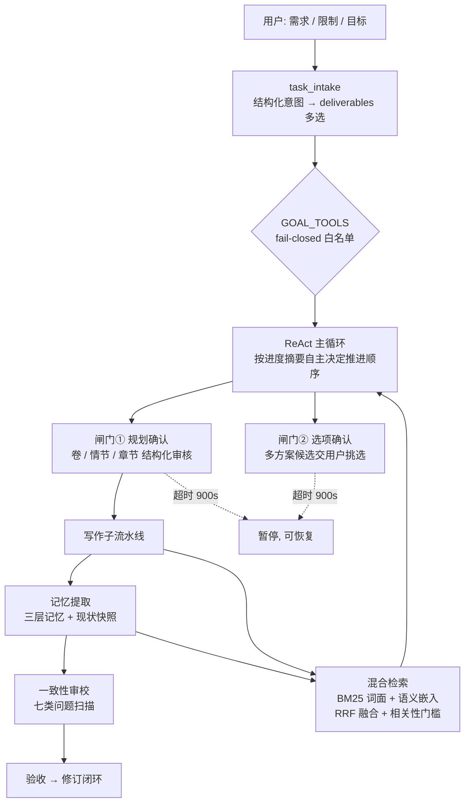

# AI 小说创作云 · 架构与评测展示层

> 一个把「灵感 → 世界观 → 角色 → 大纲 → 连载正文」整条流水线交给 **LangGraph Agent 自主推进**的
> 云平台：你给需求、限制和目标，Agent 自己规划、分段审批、逐章写作、自我验收。
> 面向长篇（数百章）场景解决两件事——**长篇不崩**（一致性）与**质量可控**（可量化评测）。


**线上演示**：[novel.matchfive.xin](https://novel.matchfive.xin)

---

## 这个仓库是什么

本仓库是线上产品的**架构与评测展示层**，不是完整源码。

产品核心实现（业务代码、提示词资产、数据集）保持闭源，因为它们承载实际产品价值；
这里公开的是三样足以判断工程能力的东西：

| 公开内容 | 证明什么 |
|---|---|
| 系统架构与关键设计决策（`docs/`） | 系统设计、边界取舍、事故驱动的演进能力 |
| 可独立运行的核心模块示例（`examples/`） | 代码质量、算法实现 |
| **一套完整的 Agent 质量评测套件**（`evals/`） | 质量工程能力——这是多数项目缺的一环 |

评测套件在本仓库**可以直接跑**（`python evals/run_eval.py --provider gold`），不需要任何私有依赖。

---

## 1. 这个系统解决什么问题

长篇创作（几百章）有两个绕不过去的难点，也是整个系统的设计起点：

- **一致性会崩**：写到第 80 章，第 3 章埋的伏笔忘了回收，角色在第 40 章就已经死过、第 70 章又出场，
  世界观设定前后矛盾。根因是上下文装不下全书，而"记住什么"是个检索问题。
- **质量无法量化**："这章写得好不好"如果只靠主观感受，任何提示词改动都是盲改。

系统的两个核心应对是**三层记忆 + 混合检索**（对抗遗忘）与**Agent 质量评测闭环**（对抗盲改）。

## 2. 架构



Agent 循环**不是状态机**——早期版本用过 7 阶段状态机，后来移除了：
阶段推进靠模型自觉、验收靠自由裁量，反而更脆弱。现在由代码算出【进度摘要】，
模型据此自主决定先做什么，**"能做什么"则由白名单裁定**。

## 3. 四个关键设计决策

| 决策 | 为什么 | 代价 |
|---|---|---|
| **工具白名单 fail-closed**（未列出的一律拒绝），而非 deny-list | 黑名单永远漏；新工具默认不可用比默认可用安全 | 新增工具必须显式挂到某个目标上 |
| **产出边界用封闭词表多选**（world/characters/outline/chapters/draft/edit），门禁按**并集 + 依赖闭包**派生 | 旧的"四档枚举"把组合需求逼进错误的桶：「只写第 3~5 章」只能选 full，等于默许动所有东西。现在「只写正文」不会顺势扩建成重建世界观 | 需要在服务端做依赖闭包推导（chapters 带 outline，draft 带 chapters） |
| **人工介入分两道门**：规划确认 + 选项确认，复用同一套 `asyncio.Event` + 900s 超时 | 只有一道门时，Agent 只能把候选方案写进自由文本里干等——前端没有可点的东西，任务却已 done（真实事故：5 套候选金手指无处可选） | 两道门的幂等与状态补写要单独处理 |
| **一致性审校用 quote 锚点而非语义相似度**做匹配 | 审校的价值一半在"指得准"——指不到具体句子用户改不了；语义匹配会把"同类但不同处"错认成命中，虚高召回 | 需要处理文本归一化与部分匹配 |

## 4. Agent 质量评测（本仓库可直接运行）

一致性审校模块上线后出现过**一次真实事故**：同一章累积 **57 条待处理问题**，
误报把用户淹没了。此前"准确率如何"只能靠主观判断，改提示词是盲改。

于是做了一套可复现的评测闭环，把一个主观问题变成了可量化的门禁：

```bash
cd evals
python run_eval.py --provider gold                    # 尺子自检：指标必须全 1.0
python run_eval.py --provider noisy --drop 0.25       # 灵敏度自检：指标必须朝坏的动
python run_eval.py --provider api --model <your-model>  # 真实模型基线
python langsmith_eval.py --upload                     # 接 LangSmith 做实验对比
```

### 评测集设计

20 条 case = **15 条人工种 bug**（覆盖七类问题）+ **3 条干净章** + **2 条诱饵章**。

诱饵章是最关键的设计：它们**看起来像 bug 但实际合法**（例如"她说：我知道你不是普通人"——
读者会以为这是知识泄露，但对照角色档案后确认她本就知情）。
只种 bug 的评测集会奖励"什么都报一遍"的模型，诱饵章才能测出真的判断力。

### 已实测的基线

| 运行 | Recall | Precision | F1 | 干净章误报率 |
|---|---|---|---|---|
| gold 自检（指标上限） | 1.000 | 1.000 | 1.000 | 0.00 |
| 低噪声注入 | 0.867 | 0.565 | 0.684 | 0.60 |
| 高噪声注入 | 0.600 | 0.273 | 0.375 | 0.80 |

> 自检的意义：gold 全 1.0 说明**指标实现本身没写错**（尺子准确）；
> 噪声注入让指标按预期方向、**沿不同维度**移动，说明各项指标之间没有被互相污染。

评测套件的设计说明与面试常见追问的答法见 [`evals/README.md`](evals/README.md)。

## 5. 目录

```
docs/
  architecture.md          系统架构与 Agent 循环
  memory-and-retrieval.md  三层记忆与混合检索设计
examples/
  retrieval/               混合检索可运行示例（BM25 + 语义 + RRF）
  agent-loop/              审批闸门与 fail-closed 门禁的骨架实现
evals/                     一致性审校评测套件（20 条评测集 + 指标 + LangSmith 接入）
```

## 6. 技术栈

**后端**：Python · FastAPI · SQLAlchemy 2.0 (async) · PostgreSQL · LangGraph · Alembic
**前端**：React 19 · TypeScript · Vite · Tailwind CSS 4 · Zustand

## License

[MIT](LICENSE)。展示层代码可自由参考；产品核心实现不在此仓库。
